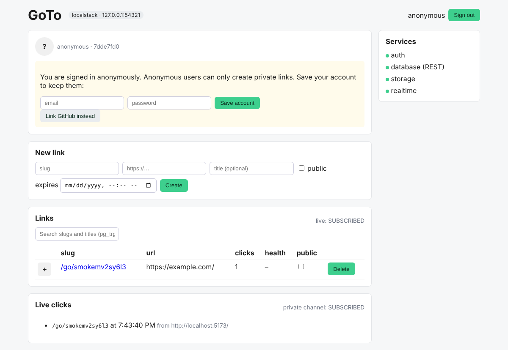

# GoTo

GoTo is a small go-links app (`/go/<slug>` → URL) built to exercise a Supabase project end
to end. The same code, config and migrations can be pointed at any project. We use it to
compare a Multigres-backed project with a regular Postgres one.



## What it uses

| Supabase feature | Where |
| --- | --- |
| **Auth**: email/password, anonymous sign-in, GitHub and Google OAuth, anonymous → permanent upgrade | `src/components/AuthPanel.tsx`, `AccountPanel.tsx`, `[auth]` in `supabase/config.toml` |
| **Database + RLS**: profiles (auto-created by a trigger on `auth.users`), links, clicks, daily stats; anonymous users restricted to private links by a restrictive policy | `supabase/migrations/…_profiles.sql`, `…_links.sql` |
| **Extensions**: `citext` (slugs), `pg_trgm` (fuzzy search), `moddatetime` (`updated_at`), `pg_cron`, `pg_net` | `…_extensions.sql` |
| **RPC**: `resolve_link` (security definer: records the click and returns the URL), `search_links` (trigram search under RLS) | `…_links.sql` |
| **Realtime**: `postgres_changes` for live click counts; a private per-user broadcast channel fed by a `realtime.send()` trigger and authorised by RLS on `realtime.messages` | `…_realtime.sql`, `Dashboard.tsx`, `ClickFeed.tsx` |
| **Storage**: public `link-icons` and private `avatars` buckets (size/MIME limits, per-user folder policies, signed URLs) | `…_storage.sql`, `LinkTable.tsx`, `AccountPanel.tsx` |
| **Cron**: purge expired links (5 min), roll up daily stats (15 min), prune old clicks (daily), and health-check public links with `pg_net` (10 min) | `…_cron.sql` |

`supabase/migrations` is the source of truth for the schema. `tests/schema.ts` mirrors it
in Drizzle for the typed-query checks.

## Targets

Each target is a `.env.<target>.local` file (gitignored). Copy `.env.example` and fill it in:

```sh
cp .env.example .env.multigres.local
cp .env.example .env.normal.local
```

For the Multigres project, `DATABASE_URL` needs `?sslmode=require&sslnegotiation=direct`.
A regular project's direct DB host is IPv6-only, so on IPv4 networks use its session
pooler URI.

For a local stack, run `supabase start` and create `.env.localstack.local` from
`supabase status -o env`, using `API_URL`, `PUBLISHABLE_KEY`, `SECRET_KEY` and `DB_URL`.

## Deploy the schema and config to a project

**Schema:** either of these works, and both record migrations in
`supabase_migrations.schema_migrations`, so you can mix them:

```sh
# Supabase CLI (needs Management API access to the project's environment)
supabase link --project-ref <ref>
supabase db push

# or a direct connection using the target's DATABASE_URL
npm run db:push -- multigres
```

**Auth config:** `supabase config push` sends `[auth]` from `config.toml`, including
anonymous sign-ins, the GitHub/Google providers (credentials from the
`SUPABASE_AUTH_EXTERNAL_*` env vars) and redirect URLs. If the CLI can't reach the
environment, set these in the dashboard:

- Anonymous sign-ins: **on**
- Manual identity linking: **on** (anonymous users can link GitHub)
- GitHub and Google providers: **on**, with callback URL `https://<ref>.supabase.red/auth/v1/callback`
- Redirect URLs: `http://localhost:5173/**`, `http://127.0.0.1:5173/**`

To start from scratch on a target, `npm run teardown -- <target>` removes GoTo's tables,
functions, policies, cron jobs, buckets and migration history. Extensions stay installed.

## Run the app

```sh
npm install
npm run dev -- multigres   # loads .env.multigres.local; the header shows which project you're on
npm run dev -- normal
```

The **Services** panel shows whether Auth, REST, Storage and Realtime respond for the
selected project.

## Test a target

```sh
npm run test:target -- multigres    # writes reports/multigres.md and .json
npm run test:compare                # multigres and normal side by side → reports/multigres-vs-normal.md
```

The suite creates throwaway users and data, runs about 46 checks across Auth, schema, RLS
via REST, Drizzle over a direct connection (RLS-as-user transaction, prepared statements),
Realtime (broadcast, presence, `postgres_changes`, private channels), Storage and Cron
(including a real pg_cron run and a pg_net request), then cleans up. DB-level checks are
skipped if `DATABASE_URL` is unset or unreachable.

See [docs/FINDINGS.md](docs/FINDINGS.md) for results so far.
